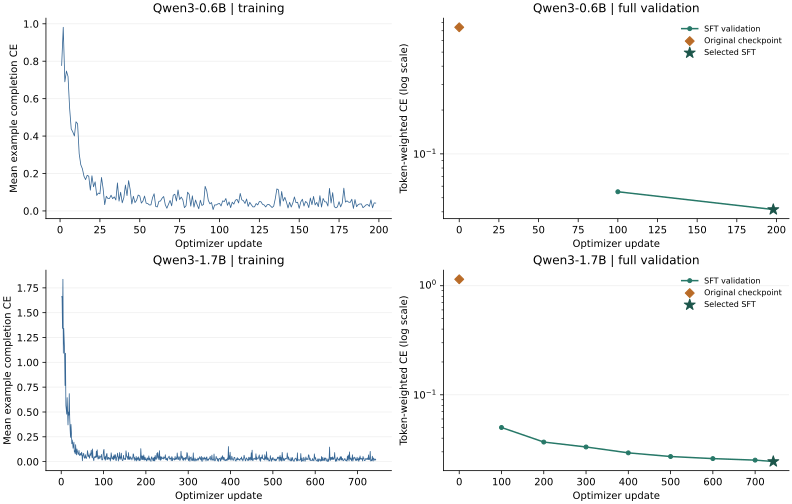

# S1｜G3 完整 SFT 与原始 checkpoint 对照

2026-10-26。**Qwen3-0.6B 和 Qwen3-1.7B 均完成冻结的一轮 LoRA SFT；在各自完整验证集上，所选 SFT 的 completion/EOS 交叉熵分别从 0.739884 降至 0.041494、从 1.145230 降至 0.024438。** 两者均选中最后一个预定验证点。全部 941 次更新、10 段恢复链及数据游标已由 S1 汇总核对，196 个文件已回收到 Mac，唯一 L4 实例已停止并确认不存在。

当前状态为 **独立终验 PASS，S1 已接纳**。[R1 技术终验](reviews/P04_CUDA_G3_FINAL_R1.md)与[Q1 数据及说明终验](reviews/P04_CUDA_G3_FINAL_Q1_R1.md)均通过，两份所选完整状态可作为 G4 的 SFT 起点。这里报告冻结 validation 上的拟合结果；工具语义、无需工具判断、故障恢复和独立测试效果属于 G5，DPO 属于 G4。

## 实际结果与选模

| 模型 | train / validation | 更新数 / 末批条数 | 原始 CE | 选定 SFT CE | SFT − 原始 CE | 所选 step |
|---|---:|---:|---:|---:|---:|---:|
| Qwen3-0.6B | 1,583 / 194 | 198 / 7 | 0.739884 | 0.041494 | −0.698390 | 198 |
| Qwen3-1.7B | 5,938 / 213 | 743 / 2 | 1.145230 | 0.024438 | −1.120792 | 743 |

两个 profile 的完整验证分母分别为 **21,226** 和 **23,841** 个监督 token。原始模型在首次更新前关闭 adapter，按同一完整 validation 计算；该点不参与 SFT 选模。SFT 每 100 步及最后一批验证，按最低有限 CE、较早 step、checkpoint 摘要的冻结规则选择。1.7B 的八个验证点从第 100 步的 0.050134 逐步降至第 743 步的 0.024438。

训练曲线是每次实际有效 batch 内的 **mean-example completion CE**；验证曲线是完整验证集的 **supervised-token-weighted CE**，包含 EOS、采用 causal shift。两种分母分别标明。两模型使用各自冻结的训练和验证 profile，表中比较均在同一模型、同一 profile 内进行。seed 固定为 42，本轮未运行多 seed 或测试集选择。



完整数值见 [941 行训练记录](experiments/p04-sft-g3/training.csv)和[12 行验证记录](experiments/p04-sft-g3/validation.csv)，包括两个原始模型点。公开 CSV 采用 LF 换行，数值与原始分析记录一致；公开 SVG 清除行末空格。右侧纵轴为对数刻度。[绘图脚本](experiments/P04_SFT_G3_PLOT.py)使用 `matplotlib==3.10.7`；从发布 CSV 重画的 PNG 与实际汇总图逐字节一致。复画命令：

```bash
python reports/experiments/P04_SFT_G3_PLOT.py --output /tmp/toolalign-g3.svg
```

## 固定源码与输入

实际执行主干为 PR26 合并提交 `2abbe7ac913661df1d5e430f285604b4ceb8ff4b`，双 Python CI 40271208505 成功。生产代码等同已审核候选 `c633bd70f4446bc8ea3ee80440944e6e6da7ff87`；原始验证实现经 R1 `fd4ad07cb4a6a083c5fc178ba30a5705cc2a9684` 独立 CPU 审查通过。

[Q1 完整数组审核](reviews/P04_CUDA_SFT_FULL_ARRAY_Q1_R1.md)提交 `98cf0e1370ff68ca3306e157be1f7c95ac37a2e9` 在 GPU 分配前被接纳。Q1逐行核对 1,777/6,151 条实际数组与冻结 v3 的身份、顺序及 mask；训练监督 token 分别为 141,211/536,238，验证分母与上文一致。13 例语义材料身份未变，复用先前审核。Mac 仅完成冻结 tokenizer 预处理、控制和分析，真实模型计算均在 Colab。

固定方案为 CUDA v2、BF16 底座、FP32 Q/V rank-8 LoRA、28 层、alpha 16、dropout 0、microbatch 1、有效 batch 8、AdamW、SDPA、非重入 checkpointing，以及 strict deterministic / warn_only=false / workspace `:4096:8`。模型 revision、tokenizer、模板、长度和优化参数均未改变，见[执行计划](../configs/sft-cuda-g3.v1.json)及[底层配置](../configs/sft-cuda.v2.json)。

| 身份 | SHA-256 |
|---|---|
| CUDA v2 配置 | `ee235d612b2552be5927b4ff790887a34b088ab842f78a15fcb8212323b60045` |
| G3 冻结计划 | `f5fa66a3842ad0c4c3de2ef64f1aec8315c806fe6799078d207c07a1f8b46ff2` |
| smoke 实际数组 manifest | `9a504ffd00b571eb5f5294d174d4285c92a695dee0d3171988d572185a860b5b` |
| formal 实际数组 manifest | `58b59c6a47be9c768835dadf020a303c801909f8ad07b1875918ee2168170d58` |
| 0.6B 所选完整 state | `e29e650615be4dbb71ff4cb50d02ecca008ddde5901c496845bdc5a4da3eb51f` |
| 1.7B 所选完整 state | `cfb02aec2279138c01f8b336abc08a588d0ab11efa8db68fd61ba0b6150b5d14` |

## 恢复、资源与失败记录

smoke 按累计 100/198 步运行，formal 按 100/200/300/400/500/600/700/743 步运行。每段保存可恢复的 adapter、optimizer/scheduler、step、cursor、RNG 和历史最佳状态，外部回收校验后才开始下一段；恢复仍需匹配固定底座和运行身份。全部事件连续，两个 profile 均完成一轮，末批分别为 7/2 条。分段是同一次训练的延续。

实际 GPU 为 NVIDIA L4、23,034 MiB；Torch 2.8.0+cu128、CUDA 12.8，沿用已验证的 Linux 依赖锁和 G2 容量方案。

| profile | trainer 总用时（秒） | Torch peak allocated / reserved（GiB） | 设备采样峰值（MiB） |
|---|---:|---:|---:|
| 0.6B smoke，2 段 | 876.210 | 2.150 / 3.787 | 4,174 |
| 1.7B formal，8 段 | 5,834.922 | 4.691 / 5.553 | 5,982 |

设备数值来自 1 秒间隔的观测采样；Torch 峰值由各 trainer 记录。全部 10 段正常退出，采样结束后导出，Mac 校验了 **196 个产物文件**。停止前控制器再次核对所有回收清单、归档和文件。实例于 **07:50:27 UTC** 停止并确认不存在；最后账户查询为 **0 active assignments、0.00 CU/hr**。

唯一实例从 05:18:22 UTC 起累计占用 **9,124.538896 / 14,400 秒**，约 152.1 分钟，包含安装、输入上传、模型下载、训练、验证、空闲与回收。账户余额从 172.94 到 169.09 CU，观测差 **3.85 / 8 CU**；这是账户余额观测，不是精确账单归因。生成证据索引时新增私有产物为 1,078,495,568 字节，低于 4 GiB 上限。

首次安装的 SSH 连接曾以 exit 255 / Broken pipe 断开，对应本地包装命令 exit 1。随后检查确认同一远端原安装进程正常结束、exit 0、依赖及 pip check 通过；没有重复提交安装或训练。该失败回执和原始日志均保留，索引中的 158 条已记录命令只有这一条非零退出。[G2 的原失败和恢复诊断](S1_P04_CUDA_V2_RECOVERY.md)也保持原结论。

上述命令索引包含一次主干冻结前的只读分母统计，源码为 `7eb0ac9`；之后在训练前补入四个计划统计字段。其余 157 条命令、实际数组及全部训练均绑定 `2abbe7ac`。R1/Q1 首轮辅助检查对该早期统计的来源假设过宽，核对原回执与 Git 时间线后已纠正，原失败输出保留；生产代码与训练证据未改动。

本轮复用 G2 已验收的底座冻结和 optimizer 参数绑定，完整 SFT 未另做底座内容全量摘要，该项保持 `NOT_RUN`。运行 summary 中的 remote copy 状态与实际外部持久化分开，Mac 回收清单提供后者证据。

## 可复核证据与验收状态

| 证据 | SHA-256 |
|---|---|
| 10 段、196 文件、158 命令及资源索引 | `be10313e0c200dde1a8c2c4660842a3d2474d9210ab7d01bda2cc506cecef544` |
| 全部事件、恢复和选模汇总结果 | `0b893cf7f2491057c1e7d7b18fc8e5baab1bf146940ecd18a116832f341d86b4` |
| 汇总命令回执 | `de4271af2ccf72122e73ae6d74d2367dce2b44265412d2cbd61e3d9a66afa3fc` |
| 公开训练 CSV（LF） | `06827869028c4b4f7c4889a71acbeb68755cd21b82fa1497f52297c32d219ac5` |
| 公开验证 CSV（LF） | `6722ec7cbcc0929b007b9cd056c93e258fd5627bc203a1a20c15de2b39765e3c` |
| 公共脚本重画回执 | `76351aeeb1a689f23896059fed7ba2ee212751df18298de959da886ed6de8e5a` |

R1 提交 `300af3f4137ecea481fe188c5994822d84221d74` 独立核对 941 次更新、12 个验证点、10 份唯一完整状态、18 份保留副本和 8 次续训链接，P0/P1/P2 均为 0。Q1 提交 `34331c2e01bac93767c12a45d48704c2ef3d8fce` 确认已审数组的实际消费、全部数值与图表、资源和解释范围。

S1 已读取两份完整报告与核对程序，回读其结果、命令和公开提交：R1 的 32 个绑定文件、Q1 的 744 个输入副本及公开字节一致，原辅助检查失败与纠正记录保留，未发现候选缺陷。接纳回执 SHA-256 为 `213b0d3a74a62bf16cef02032e69643cdb523b4004cb6079023daeec22eb3550`。结果与独立报告合入主干后完成 G3，随后进入 G4 偏好生成与 DPO；不重复完整 SFT。
