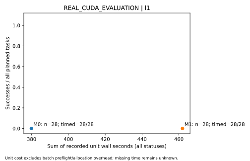

# S1｜G5 独立评测与归因

2026-10-27。冻结28题的实际CUDA对照中，**M0与M1完整任务成功率均为0/28，配对差为0个百分点**。M1首动作的Action格式合法率为28/28，M0为1/28；M1全部66个合法动作均为`tool_calls`，没有产生合法`final`或`clarify`。这支持“工具调用格式拟合改善，但完整任务未获得成功”的结论。原G3验证CE下降继续成立，其监督目标全为工具调用，不能替代观察后的回答、无需工具判断和终止能力评测。

恢复开启时，8/8次注入错误后完成了同工具、同参数重试，但随后都继续请求工具并触及轮数上限；开启/关闭恢复的任务成功均为0/8。A2的12对原始输出全部一致，4次重复输入实际命中缓存，命中请求prefill减少34.70–39.49毫秒；全部12次请求总耗时从91.175秒降至91.006秒。后续G6交付按此效果边界提供受限实验接口。若以后开展新训练，应在独立train材料中验证最终回答、澄清及无需工具监督覆盖；本轮测试题和输出不反馈训练或选模。

唯一L4已停止并确认无活动分配；累计2,358.235秒，余额观测差0.89 CU，245份产物已验证回收，124个owned模型/工具进程均已回收。R1技术终验与Q1结果说明终验均PASS，S1已回读接纳，新增实质问题0；PR34主干核对已通过，G5 App goal已complete。

## 冻结范围与执行身份

实际源码为[PR33](https://github.com/kris0516/ToolAlign/pull/33)主干`19f6f9bbc3710487634765854f74f9af3fc80eef`；最终PR头的双Python CI 40388206384成功，合并后完整文件树相同。语料经[R1 bb4fc27](reviews/P06_G5_CORPUS_R2.md)和[Q1 cb4c72d](reviews/P06_G5_CORPUS_Q1_R2.md)正式接纳：28题、四个各7题的实际连通组、六类任务，其中8题注入恢复故障。原48题永久隔离，未进入本次推理。

[冻结协议](../coordination/tasks/P06_G5_PROTOCOL.md)的模型、模板、工具、oracle、seed、运行计划及采样在首次推理前固定，结果出现后未调整。M0为Qwen3-1.7B原始指令checkpoint；M1为同底座加G3选中的step743 LoRA。revision为`70d244cc86ccca08cf5af4e1e306ecf908b1ad5e`，checkpoint SHA256为`cfb02aec2279138c01f8b336abc08a588d0ab11efa8db68fd61ba0b6150b5d14`，adapter为`973c440e29090892ad11d6d56b94bad4c98a5398c223e2b4302d7dba7c4640ed`。

两模型共同使用BF16底座、完整schema、non-thinking Action模板、2048上下文、每次256新token、temperature 0.7、top_p 0.9及top_k 0。每题seed为42+i，每次决策重置；同题按预先奇偶规则交替模型顺序。每条最多3次决策、2轮工具、30秒，包含冷加载；主比较cache off、recovery on。M2因G4无合格偏好保持NOT_RUN。

| 输入或运行 | SHA256 |
|---|---|
| L1冻结tasks | `a645b445d37a66522c39d83d110b6384abe8e0e93b15ad4ff8b208eb7eb2b54f` |
| L1/A1运行配置 | `34dfdae1e84c60374f6995159d087566d38010f0209112a9b862f0a5de2237a9` |
| L1/A1原始结果 | `001709eac0905a9bf279396ad1d3c1b288ca9a6af3d1c47c51e65ce1f2cf0a89` |
| 原A2开发输入 | `ec282f4779deca1815af39e2c68c846e831c184965318f3550eeaff973d03166` |
| A2运行配置 | `27dec517e6ee71928d143f07efaf82d210d91daf85d1808e5183b73721c2427f` |
| A2原始结果 | `5fb5526bd012c7995b555409c1c13aa92d72c9387dd778e228aec1fb0c74c134` |

L1/A1全部64个单元及A2全部8个序列单元均有started、terminal和原始记录，未启动数为0；没有重跑已启动失败。S1回读104个L1/A1实际ModelInput、24个回放请求、116份执行源码身份、实际模型身份及全部进程回收记录。三段外层均exit0且未触及段时限；外层完成不等于任务成功。

## L1任务结果与失败位置

| 类别 | M0成功 | M1成功 |
|---|---:|---:|
| 单工具 | 0/4 | 0/4 |
| 多步依赖 | 0/4 | 0/4 |
| 相近工具语义 | 0/4 | 0/4 |
| 无需工具 | 0/4 | 0/4 |
| 观察后澄清 | 0/4 | 0/4 |
| 有限恢复 | 0/8 | 0/8 |
| 全部冻结任务 | **0/28** | **0/28** |

四个实际连通组分别覆盖累计quorum移除、区间并集/补集、依赖闭包/拓扑次序、去重分片存活关系；各组M0与M1均为0/7。按冻结seed42进行10,000次整组配对bootstrap，差值95%分位区间为[0,0]；每次去掉一个组，剩余21题差值也为0。所有观测差值均为0使经验重采样区间退化；它描述这四组的经验稳定性，不证明未来任务上的等价性或总体覆盖率，也不测量训练seed方差。

| 原始终止原因 | M0（28条） | M1（28条） |
|---|---:|---:|
| `parse_failure` | 27 | 1 |
| `invalid_arguments` | 0 | 14 |
| `tool_round_limit` | 0 | 12 |
| `backend_error`，实际stage为`context_overflow` | 0 | 1 |
| 完整返回但答案/允许策略不匹配 | 1 | 0 |

M0的27条解析失败包括消息封套复述和代码围栏中的答案等；其唯一合法`final`没有完成所需观察且答案不匹配。M1的68次决策中66次Action结构合法，另一次在读到观察后产生非法JSON，一次因上下文溢出未生成输出。4道无需工具题都先请求工具，4道澄清题均未返回`clarify`。没有将格式合法、工具成功执行或冷加载完成记为任务成功。

以下为冻结分析器对`tool_execution`事件的诊断口径；工具轮数耗尽前被拒的后续请求不进入该调用分母。前缀语义匹配要求此前调用也满足允许策略，不能把这列解释为彼此独立的单参数正确率。

| 诊断 | M0 | M1 | M1 recovery off |
|---|---:|---:|---:|
| 全部决策raw格式合法 | 1/28 | 66/68 | 8/8 |
| 调用前缀工具名匹配允许策略 | N/A（0调用） | 34/56 | 8/8 |
| 调用前缀工具名及语义参数匹配 | N/A | 29/56 | 8/8 |
| 实际调用返回completed | N/A | 34/56 | 0/8 |
| 调用未提供的工具 | N/A | 0/56 | 0/8 |
| 额外调用：确定是 / 确定否 / unknown | N/A | 20 / 29 / 7 | 0 / 8 / 0 |
| 已观察可重试错误后同工具同参数完成 | N/A | 8/8 | 0/8 |
| 记录预算耗尽事件的轨迹 | 0/28 | 12/28 | 0/8 |

上下文溢出发生于一条无需工具题：模型两次决策共请求4个工具调用，第三次实际输入达1,991 tokens，加256预留超过2,048。原终态仍为`backend_error`，具体原因单列`context_overflow`；没有CUDA OOM，也没有据此扩大预算或重跑。原始输入、两次返回及5个回收child均保留。

## A1恢复与A2缓存

恢复开启的8题在首次瞬时错误或工具超时后，均完成相同参数的重试，继而在第三次决策请求额外工具，全部以`tool_round_limit`结束。关闭恢复时8条首动作与对应开启条目逐字节相同，首次可重试错误即停止，四条`injected_transient`、四条`tool_timeout`。两条件均0/8、差值0；四组每组2题的区间及去一组差值均为0，解释范围同主比较。

| 8题配对恢复成本 | off | on |
|---|---:|---:|
| 轨迹总耗时 | 87.445秒 | 145.241秒 |
| 平均轨迹耗时 | 10.931秒 | 18.155秒 |
| 决策数 | 8 | 24 |
| 输入 / 输出tokens | 6,741 / 288 | 23,881 / 991 |

开启恢复多耗时57.796秒；重试取回观察的机制有效，但没有带来完整答案。恢复on的8条已包含在M1主比较中，不重复计入GPU账目。

A2为预先冻结的4组开发请求，每组3次，同一child内执行，cache off/on交替顺序。前两次ModelInput相同、seed按既定序号不同；第三次换输入。24次请求全部完成，12对相同位置的off/on原始输出均相同。开启缓存时每组第二请求分别命中1,295、1,298、1,294、1,289 tokens，总计5,176；首次及第三次请求均0命中，关闭缓存的12次均0命中。该项测量请求回放，不产生任务成功分数。

| A2，全部12请求 | cache off | cache on |
|---|---:|---:|
| request wall总和 | 91.175秒 | 91.006秒 |
| 4个序列unit wall总和 | 92.291秒 | 92.117秒 |
| prefill总和 | 2.749秒 | 2.594秒 |
| TTFT总和 | 3.681秒 | 3.502秒 |
| decode总和 | 60.039秒 | 60.143秒 |
| 输入 / 输出tokens | 15,529 / 782 | 15,529 / 782 |

4次命中的prefill各减少34.70–39.49毫秒，TTFT各减少34.73–39.99毫秒；其中一次完整请求反而增加39.01毫秒。全部请求wall总和减少0.169秒，约0.185%。四组单次回放支持局部prefill复用的实测收益，不能据此宣称稳定的端到端吞吐提升；冷加载及decode占主要耗时。

## 质量、成本与资源



图和下表包含全部失败轨迹。M0每题一次决策，M1平均2.43次；耗时差同时包含所走轨迹、输出长度与加载差异，不能全归因于adapter计算开销。

| 实测成本 | M0（28条） | M1（28条） | recovery off（8条） |
|---|---:|---:|---:|
| unit wall总和 | 379.883秒 | 461.966秒 | 87.445秒 |
| unit wall平均 / p50 | 13.567 / 14.099秒 | 16.499 / 15.633秒 | 10.931 / 10.931秒 |
| unit wall p95 / 最大值 | 18.885 / 21.964秒 | 20.616 / 23.671秒 | 11.469 / 11.545秒 |
| 冷加载平均 | 6.032秒 | 6.557秒 | 6.490秒 |
| 决策数 | 28 | 68 | 8 |
| 输入tokens | 24,162 | 69,299 | 6,741 |
| 输出tokens | 3,104 | 3,021 | 288 |
| 已测TTFT / prefill / decode总和 | 17.427 / 11.204 / 182.567秒 | 22.210 / 15.899 / 230.095秒 | 5.230 / 3.475 / 21.939秒 |
| 上述生成阶段有记录的请求 | 28/28 | 67/68 | 8/8 |
| queue总和 | 4.776秒 | 4.998秒 | 1.354秒 |
| Torch最大allocated / reserved | 3,645,095,424 / 3,682,598,912 bytes | 3,711,670,784 / 3,787,456,512 bytes | 3,629,329,920 / 3,676,307,456 bytes |

L1/A1全部104次请求的token计数完整；上下文溢出的生成阶段时间缺失保持unknown。该路径未记录独立的每请求wall字段，不能用unit wall冒充请求耗时。冷加载从tokenizer构建到CUDA就绪，不含批次文件预检；TTFT/prefill/decode为生成阶段指标，不含冷加载。50段工具执行到观察事件耗时共18.945秒，包含故障和超时；所有尾延迟样本数少于100，p95作探索性描述。

| 分段 | 完整段耗时 | 其中模型文件预检 | 设备采样峰值 | 回收文件 |
|---|---:|---:|---:|---:|
| 容量探针 | 31.646秒 | 12.088秒 | 3,926 MiB | 23 |
| L1/A1 | 944.001秒 | 12.012秒 | 3,876 MiB | 143 |
| A2 | 197.065秒 | 11.984秒 | 3,838 MiB | 79 |

实际设备为L4、23,034 MiB；三段分别采样32、907、191次，目标间隔1秒，数值为采样峰值。L1/A1模型child最高host RSS为4,312,961,024 bytes，外层host RSS为130,580,480 bytes，不能与GPU显存相加。

容量探针两模型各输入1,792 tokens、实际输出27/33，最长实际序列1,825 tokens；两条Action解析失败按运行前规则单列，容量条件PASS不代表效果。全部分段共1,172.712秒；加上同一分配中的安装、失败连接、传输、空闲及回收1,185.524秒，共2,358.235秒。分配从2026-10-26 19:45:09 UTC起，20:24:27 UTC确认停止和缺席；账户余额167.21→166.32 CU，观测差0.89 CU。低于单次7,200秒及G5总14,400秒/8 CU上限。三段2+114+8个owned进程全部回收；原安装中SSH断开和上传连接失败记录保留，未增加模型轨迹。

## 实际失败案例

私有索引保存全部64个失败单元及其raw Action、可见输入、观察、oracle与终态hash。下列21例按“条件×类别×终止原因”首例、四组覆盖和冻结序号补足20例，再加入被选恢复off的对应on案例；用于解释失败，不作为新效应估计。公开表仅给行为摘要，不发布原始题目、答案或轨迹。

| unit | 条件 / 类别 | 实际行为与终态 |
|---:|---|---|
| 0 | M0 / 单工具 | 输出围栏内裸答案并引用未观察的分区，未形成Action；`parse_failure`。 |
| 1 | M1 / 单工具 | 正确读取后又请求检查工具，遗漏必需布局标识；`invalid_arguments`。 |
| 2 | M1 / 多步 | 提交移除全部实例的方案，观察到不满足quorum后继续请求检查；`tool_round_limit`。 |
| 3 | M0 / 多步 | 用message_index/message封套复述用户输入；`parse_failure`。 |
| 4 | M0 / 工具语义 | 返回消息封套，未形成Action；`parse_failure`。 |
| 5 | M1 / 工具语义 | 增加前置读取，随后把分阶段嵌套数组写成扁平数组；`invalid_arguments`。 |
| 6 | M1 / 无需工具 | 已给完整材料仍请求4个调用，第三次输入加生成预留超限；`backend_error/context_overflow`。 |
| 7 | M0 / 无需工具 | 复述完整输入到消息封套，未作答；`parse_failure`。 |
| 8 | M0 / 澄清 | 在消息封套内嵌工具信息，没有合法Action；`parse_failure`。 |
| 9 | M1 / 澄清 | 读取冲突条件后继续请求工具，参数含非法JSON集合写法；`parse_failure`。 |
| 10 | M1 / 瞬时错误恢复 | 正确重试取得观察，随后请求额外检查；`tool_round_limit`。 |
| 11 | M0 / 恢复 | 首次输出为消息封套复述，未触达注入故障；`parse_failure`。 |
| 13 | M1 / 超时恢复 | 正确重试后请求额外检查，并改变移除阶段内容；`tool_round_limit`。 |
| 17 | M1 / 多步 | 读到区间后用calendar代替必需timeline_id，窗口也未选择要求的空闲区间；`invalid_arguments`。 |
| 21 | M1 / 无需工具 | 重新读取已给材料，再调用缺少timeline_id的测量；`invalid_arguments`。 |
| 22 | M1 / 澄清 | 应根据读到的区间提出澄清，却请求缺少timeline_id的测量；`invalid_arguments`。 |
| 23 | M0 / 澄清 | 返回合法final，未执行所需观察，动作种类与内容不符合允许答案；语义失败。 |
| 29 | M1 / 单工具 | 完成一次读取后增加检查并再次请求，未输出最终答案；`tool_round_limit`。 |
| 50 | M1 / 澄清 | 读取分片约束后执行检查并继续请求，未给澄清；`tool_round_limit`。 |
| 56 | M1 off / 瞬时错误恢复 | 首次读取收到可重试错误，开关关闭按约终止；`recovery_disabled:injected_transient`。 |
| 57 | M1 off / 超时恢复 | 首次读取超时，开关关闭按约终止；`recovery_disabled:tool_timeout`。 |

## L2处置与复算入口

官方BFCL固定版本`f7cf7359b7ac615a0b294831c5ba2bc95ee4a000`下，按预先文件顺序检查三类各50条，共150条、227个函数根schema；均未显式关闭根schema，严格无损契约下0合格。R1/Q1已接纳[NO_ELIGIBLE_INPUTS处置](reviews/P06_G5_BFCL_DISPOSITION_Q1_R1.md)。没有补schema、扩大筛选或改用自建分数；L2模型评测及正式官方评分NOT_RUN，分数不定义。CPU官方checker原创案例不替代官方模型成绩。

公开[汇总JSON](experiments/p06-g5/summary.json)保存全部聚合诊断、成本、分组和A1/A2结果；图由现有`toolalign.evaluation.analysis.quality_cost_plot`生成。私有交付入口为`.toolalign-local/evidence/s1-g5-preparation-r1/final-evidence-index.json`，绑定冻结输入/运行配置、三次回收、停止与CU记录、分析命令及全64条和精选21条失败索引。使用原已锁定分析环境，可从各回收目录的`output`复算：

```bash
python -m toolalign.evaluation.analysis --inputs "$L1_INPUTS" --run-root "$L1_RECOVERED/output" --output "$NEW_PRIVATE_ANALYSIS" --plot
python -m toolalign.evaluation.analysis --inputs "$REPLAY_INPUTS" --run-root "$REPLAY_RECOVERED/output" --output "$NEW_PRIVATE_REPLAY_ANALYSIS"
```

输出目录须为新的私有目录，原始结果保留。复画公开质量成本图可直接将汇总JSON传给`quality_cost_plot`，无需原始题目或模型。

## 独立终验与S1接纳

[R1技术终验](reviews/P06_G5_FINAL_R1.md)提交`b52c7115dba09c5f83faab24f0a95baf04694280`与[Q1结果说明终验](reviews/P06_G5_FINAL_Q1_R1.md)提交`c4ef4645eb032d4884dc2f6ec8a414cb6f2383a6`均PASS，实际审核者为独立AI，新增问题0。受检结果候选为`e5a46265a5621d882020906d69939293d25fda66`，原S1总索引SHA-256为`c9cab39cee0e9563f7cb39f0b5815ccaf6c7e6aa409b5fd34188585d6d7478fd`。

S1逐项回读R1的540份、Q1的523份私有证据、各两份公开文档与完整审核脚本，确认报告、精确提交及hash绑定后接纳。R1五项独立检查通过，130次实际输入的固定tokenizer计数一致，独立复算分组统计、成本与全部回收记录；Q1重建104次L1输入并逐例核对21例失败。审核未新增模型推理或GPU作业，未重跑未改变的CPU矩阵。

R1索引SHA-256为`071f81cee2b9f2e7136025eefd2c5a3429c51742db7486858f8aca5a029d31d9`，Q1索引为`57400702e8ee6e8ffd04ee7941d60810a23eda84e2444d8facd0107e722e2338`。原安装/传输、S1时钟差汇总断言及R1依赖数笔误的失败记录均保留，未改变模型结果或新增正式修订失败轮次。G5按完整负结果、M2缺失和L2零合格处置验收；不据此增加训练或扩大测试预算。

PR34合并主干为`98d642a116da94f2ab2b2aaeb6e931f79fd5cabc`，最终头`3730b048119d448da013aca6e9079661a587c936`的双Python CI 40400234474全部成功。S1核对主干完整文件树与受检头相同、工作树干净，复用该精确头检查，不重跑未改变的模型或CPU测试；随后实际关闭G5并创建G6。
